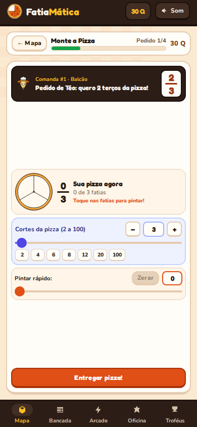

# FatiaMática

Pizzaria das Frações é um aplicativo educativo desenvolvido em React Native, Expo e TypeScript para apoiar estudantes do 6º ano no aprendizado de frações.

O projeto transforma conceitos matemáticos em atividades visuais: montar pizzas, comparar frações, reconhecer equivalências, posicionar valores na reta, relacionar frações com decimais, calcular frações de quantidade e realizar operações com denominadores comuns.

## Equipe

<table>
  <tr>
    <td align="center">
      <a href="https://github.com/AnaRosa2">
        
        <br />
        <sub><b>Ana Rosa</b></sub>
      </a>
    </td>
    <td align="center">
      <a href="https://github.com/Gisele002">
        
        <br />
        <sub><b>Gisele Dias</b></sub>
      </a>
    </td>
    <td align="center">
      <a href="https://github.com/WesleyTiagg">
        
        <br />
        <sub><b>Wesley Tiago</b></sub>
      </a>
    </td>
    <td align="center">
      <a href="https://github.com/Nilson-Rodrigo">
        
        <br />
        <sub><b>Nilson Rodrigo</b></sub>
      </a>
    </td>
  </tr>
</table>

## Objetivos do projeto

- Apresentar frações como parte de um todo de forma visual.
- Relacionar numerador e denominador a uma representação concreta.
- Permitir que o estudante teste respostas, receba feedback e tente novamente.
- Registrar progresso e estrelas de forma local.
- Trabalhar sem depender de API ou conexão com a internet.
- Manter uma arquitetura organizada para testes e evolução.

O conteúdo matemático e as atividades estão alinhados principalmente às habilidades BNCC EF06MA07, EF06MA08, EF06MA09 e EF06MA10.

## Como o aplicativo funciona

### Vídeo de demonstração

<p align="center">
  
</p>

[Baixar ou abrir o vídeo da demonstração](docs/videos/demonstracao-fatiamatica.webm).

O vídeo mostra a entrada no aplicativo, o acesso ao mapa, a abertura da atividade Monte a Pizza, a transição pela Oficina e o retorno ao mapa.

### Prévia das telas

| Entrada | Mapa da aventura |
|---|---|
|  |  |
| Boas-vindas e acesso à Pizzaria. | Mundos, estrelas, nível, Queijos e oficinas disponíveis. |

| Monte a Pizza | Oficina do Chef |
|---|---|
|  |  |
| Escolha de cortes, fatias pintadas e feedback da fração. | Compra e equipamento de chapéus, sabores e títulos. |

As imagens representam a interface executada no Expo Web em viewport mobile. Elas são capturas visuais, não substituem validações em aparelho Android, TalkBack ou avaliação com estudantes.

### Entrada

Ao abrir o aplicativo, o usuário vê a tela de boas-vindas da Pizzaria FatiaMática. A entrada leva ao mapa da aventura e permite iniciar as atividades.

### Mapa da aventura

O mapa reúne os mundos disponíveis e mostra:

- Nome do chef;
- nível e experiência;
- Queijos disponíveis;
- estrelas obtidas;
- títulos equipados;
- acesso às atividades e à Oficina.

### Atividades

| Rota | Tela | O que o usuário faz |
|---|---|---|
| `/pizza` | Monte a Pizza | Escolhe cortes, pinta fatias e monta a fração solicitada pelo cliente |
| `/compare` | Duelo de Pizzas | Compara duas frações e responde se uma é maior, menor ou equivalente |
| `/equivalent` | Frações Equivalentes | Escolhe representações equivalentes à fração de referência |
| `/decimal` | Medidor Decimal | Relaciona frações positivas a decimais exatos |
| `/number-line` | Reta Numérica | Posiciona ou identifica uma fração na reta |
| `/quantity` | Quantidade | Calcula uma fração de uma quantidade informada |
| `/operations` | Operações | Soma ou subtrai frações com denominadores comuns |
| `/arcade` | Duelo Relâmpago | Responde perguntas rápidas em modo com ou sem relógio |
| `/sandbox` | Bancada Mágica | Mistura e compara frações em um ambiente de experimentação |

### Progresso e revisão

A tela `/progress` mostra:

- Número de acertos;
- estrelas por mundo;
- conquistas;
- histórico de tentativas;
- opção de revisar o progresso;
- opção de confirmar o reset completo dos dados.

### Oficina

A tela `/shop` permite gastar Queijos em:

- Chapéus;
- coberturas;
- títulos;
- itens desbloqueados para o perfil.

O sistema impede compras sem saldo suficiente e informa visualmente o que está ativo.

### Sobre

A tela `/about` apresenta informações sobre o projeto e a equipe.

## Fluxo principal de uso

1. O usuário abre o aplicativo.
2. Seleciona **Entrar na Pizzaria**.
3. Entra no mapa da aventura.
4. Escolhe uma atividade, como **Monte a Pizza**.
5. Ajusta o número de fatias e pinta a quantidade solicitada.
6. Confere a resposta.
7. Recebe feedback correto ou uma dica para tentar novamente.
8. Ao concluir a rodada, ganha experiência, Queijos e estrelas.
9. O progresso fica salvo no dispositivo.
10. O usuário pode consultar tentativas e revisar o que errou em `/progress`.

## Persistência e funcionamento offline

O progresso é armazenado localmente com `@react-native-async-storage/async-storage`.

As implementações em memória existentes permitem executar testes e desenvolver sem depender de persistência externa. O container de DI decide qual implementação será usada.

Não são necessários login, API, banco remoto ou servidor para as funções principais do MVP.

## Arquitetura

O projeto utiliza MVVM Sofisticado:

```text
src/
├── app/          Rotas finas do Expo Router
├── view/         Telas e componentes visuais
├── viewmodel/    Estado, ações e navegação
├── usecase/      Regras de negócio e coordenação
├── model/        Entidades, contratos e erros de domínio
├── infra/        AsyncStorage, memória e serviços reais
└── di/           Construção e ligação das dependências
```

### Responsabilidades

- `app/`: conecta uma rota fina à tela correspondente em `view/`.
- `view/`: renderiza estado e recebe ações; não navega nem acessa dados.
- `viewmodel/`: mantém estado, executa Use Cases e controla navegação.
- `usecase/`: valida entradas e aplica regras matemáticas e de progresso.
- `model/`: contém entidades e contratos sem bibliotecas externas.
- `infra/`: implementa persistência e serviços.
- `di/container.ts`: instancia a infraestrutura e cria os Use Cases.

O checker arquitetural impede imports incorretos e violações das regras do projeto.

## Design System

A interface utiliza exclusivamente valores definidos em `src/view/theme.ts`.

Cores, espaçamentos, tipos, bordas e raios não devem ser escritos literalmente nas telas ou componentes.

O sistema oficial está em `docs/design-system/`, incluindo:

- princípios;
- tokens;
- fundamentos;
- componentes;
- padrões de interação;
- acessibilidade;
- estado da evolução visual.

## Pré-requisitos

- Node.js compatível com Expo SDK 58
- npm
- Android Studio e emulador, ou dispositivo Android com Expo Go/build compatível
- Maestro, caso execute os fluxos Android
- Playwright, caso execute os fluxos Web E2E

## Instalação

Na raiz do projeto:

```bash
npm install
npx expo install --fix
```

Não edite manualmente diretórios nativos `android/` ou `ios/`.

## Executar no Expo

### Web

```bash
npm run dev
```

O servidor padrão é iniciado em:

```text
http://localhost:3000
```

### Expo geral

```bash
npm start
```

### Android

```bash
npm run android
```

Use um emulador aberto ou um aparelho com o ambiente Expo configurado.

## Verificação do Harness

```bash
npm run check
```

Esse comando executa:

```bash
node scripts/check-arquitetura.mjs
tsc --noEmit
```

O projeto não deve ser considerado válido se o checker reportar erros arquiteturais.

## Testes automatizados

```bash
npm test
```

As suítes estão organizadas por responsabilidade:

- `__tests__/unit/`: cálculos, validações, regras e infraestrutura;
- `__tests__/components/`: renderização e acessibilidade de componentes;
- `__tests__/components-mocked/`: isolamento de dependências;
- `__tests__/hooks/`: comportamento das ViewModels;
- `__tests__/integration/`: integração real entre View, ViewModel, Use Case e dados.

### Cobertura

```bash
npm run test:coverage
```

O relatório HTML é gerado em:

```text
coverage/lcov-report/index.html
```

A pasta `coverage/` é gerada e não deve ser enviada ao Git.

O Jest está configurado para exigir pelo menos 80% em statements, branches, functions e lines.

## Fluxos E2E

Os fluxos Maestro estão em:

```text
.maestro/01-boas-vindas-e-nome.yaml
.maestro/02-oficina-compra-titulo.yaml
.maestro/03-atividade-pizza-e-trofeus.yaml
```

Com Maestro instalado e um emulador ou dispositivo Android disponível:

```bash
maestro test .maestro
```

Os fluxos cobrem:

1. boas-vindas, edição de nome e som;
2. compra de título na Oficina;
3. atividade da Pizza, Troféus e reset de progresso.

Esses fluxos Android não foram validados neste ambiente Linux sem emulador físico conectado.

## Estrutura de pastas

```text
src/app/                 Rotas
src/view/                Telas
src/view/components/     Componentes puros
src/view/theme.ts        Tema oficial
src/viewmodel/           ViewModels
src/usecase/             Regras de negócio
src/model/               Entidades e contratos
src/infra/               Adaptadores reais e em memória
src/di/                   Container de dependências
__tests__/               Testes automatizados
.maestro/                Fluxos Android E2E
docs/engenharia/         Requisitos, casos de uso e rastreabilidade
docs/design-system/      Kit oficial de design
docs/harness/            Regras e registros do projeto
```

## Características ISO/IEC 25010 consideradas

- **Adequação funcional:** testes unitários das operações com frações e dos Use Cases.
- **Confiabilidade:** persistência local, recuperação de dados e tratamento de `DomainError`.
- **Usabilidade:** feedback, dicas, acessibilidade e estados visíveis.
- **Manutenibilidade:** separação em camadas e importações auditadas.
- **Compatibilidade:** Expo, React Native Web e Android.

Os resultados automatizados não substituem validações pedagógicas com estudantes, testes em aparelho Android real ou revisão de acessibilidade com leitor de tela.

## Estado atual e limitações

Itens que devem ser tratados como evidência real executada:

- Verificador arquitetural e TypeScript: executados.
- Suíte Jest: executada localmente.
- Cobertura: gerada localmente.
- Expo Web: deve ser conferido manualmente no navegador.
- E2E Maestro: depende de emulador ou dispositivo Android.
- TalkBack: depende de aparelho ou emulador configurado.
- Avaliação pedagógica com crianças: não executada.
- Diagnóstico adaptativo: fora do MVP atual.

## Documentação

Leia antes de alterar o projeto:

- `AGENTS.md`
- `docs/harness/00-estado-e-gates.md`
- `docs/harness/01-arquitetura-mvvm.md`
- `docs/harness/02-convencoes-de-codigo.md`
- `docs/harness/03-expo-e-react-native.md`
- `docs/harness/04-views-e-design-system.md`
- `docs/engenharia/README.md`
- `docs/engenharia/requisitos.md`
- `docs/engenharia/casos-de-uso.md`
- `docs/engenharia/matriz-bncc.md`
- `docs/design-system/README.md`
