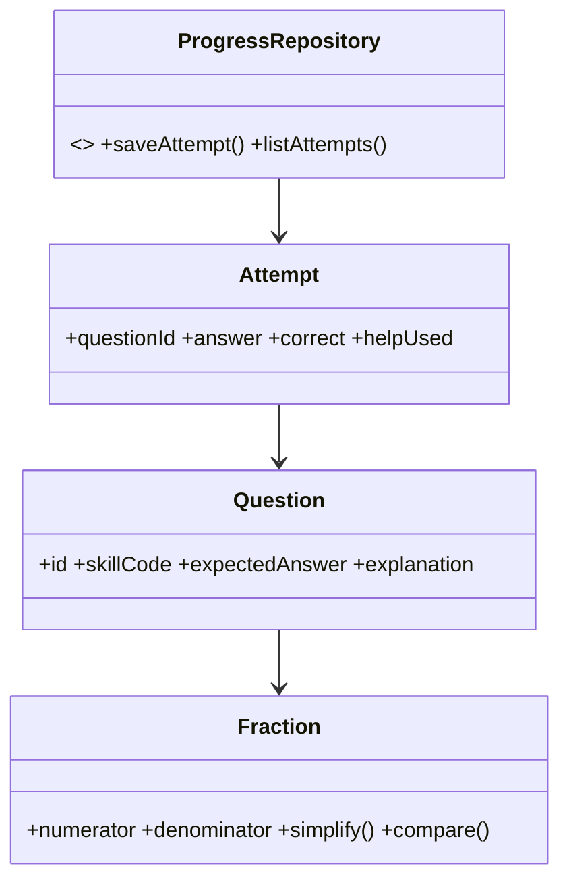

# Modelo de domínio e contratos futuros

**Fração:** `numerador: integer`, `denominador: integer > 0`; normalização por MDC; sinal padronizado; `equivalente(a,b)` via produtos cruzados; `comparar(a,b)` sem floats; `somar`, `subtrair`, `fracaoDeQuantidade`. Números grandes exigem política explícita para evitar overflow JS (por exemplo, BigInt internamente com serialização).

**Questão:** id, habilidadeBNCC, objetivo, enunciado, representação, respostaEsperada, explicacao, dificuldade. **Tentativa:** questaoId, resposta, correto, ajudaUsada, instante local. **Progresso:** habilidade, tentativas, acertos, revisões, versão do esquema.

**Portas:** `ProgressRepository` (`saveAttempt`, `listAttempts`, `getSkillProgress`), `AudioFeedback` opcional (`play` com fallback silencioso). **Invariante:** persistência local não deve armazenar nome, telefone, e-mail ou identificadores pessoais.

Diagrama conceitual:

