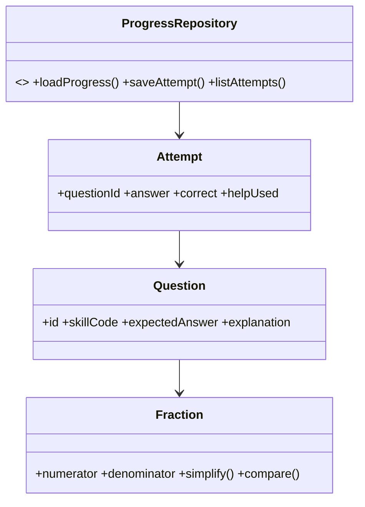

# Modelo de domínio e regras matemáticas futuras

Modelo futuro: contratos de questão, tentativa, progresso e persistência estão documentados abaixo; regras matemáticas e limites numéricos são **propostas para aprovação**, não decisões aprovadas nem implementação. Consulte também [matriz-bncc.md](matriz-bncc.md) e [especificacao-pedagogica.md](especificacao-pedagogica.md).

## Fração e representações

- Uma fração de domínio é o par de inteiros `n/d`, com `d > 0`. O domínio didático desta etapa usa valores não negativos: `n >= 0`. Numerador e denominador negativos e resultados negativos ficam fora do escopo proposto. A validação do denominador ocorre antes de qualquer divisão ou simplificação.
- **Parte de um todo:** dividir um inteiro em `d` partes de mesma área/quantidade e considerar `n` dessas partes. O denominador conta partes iguais; o numerador conta as partes consideradas. Para uma única figura inteira, esta interpretação é direta quando `0 <= n <= d`. A figura não deve sugerir que partes desiguais representam a mesma fração.
- **Resultado de divisão/partilha:** `n/d` também representa o quociente `n ÷ d`; por exemplo, 3 unidades repartidas igualmente entre 4 pessoas dão `3/4` de unidade para cada uma. Essa interpretação não deve ser reduzida ao desenho de uma única pizza.
- **Fração própria:** `0 <= n < d`; seu valor está entre 0 e 1. **Fração imprópria:** `n >= d`; seu valor é pelo menos 1. As duas são frações válidas. A representação parte-todo de um único inteiro não basta para uma fração imprópria: usar mais de um inteiro ou a reta.
- **Número misto:** forma alternativa para fração imprópria não negativa, `n/d = q + r/d`, em que `q = n div d` e `r = n mod d`. Exemplo: `7/4 = 1 3/4`. Não é um valor diferente nem substitui a forma fracionária; quando `r = 0`, a apresentação pode ser o inteiro `q`. Seu uso em conteúdo é proposta; decidir se será ensinado como objetivo ou somente apresentado como representação.
- Denominador zero é inválido: `n/0` não define uma fração e não pode ser reduzido, comparado, representado ou usado em operação. O caso deve ser rejeitado antes de qualquer divisão.
- Numerador zero é válido quando `d > 0`: `0/d = 0`. O par canônico é `0/1`; uma atividade pode conservar `0/4` como forma de exibição contextual, sem confundi-lo com o par canônico interno.

## Equivalência, simplificação, comparação e ordenação

- `n1/d1` e `n2/d2`, com denominadores positivos, são equivalentes se representam o mesmo racional. Pode-se verificar por produtos cruzados exatos: `n1*d2 == n2*d1`. Não comparar por divisão em ponto flutuante.
- Simplificar divide numerador e denominador pelo `mdc(|n|, d)`. Para `n = 0`, a forma reduzida é `0/1`. Nunca simplificar para denominador zero.
- A normalização interna guarda uma única forma canônica por valor. A apresentação pedagógica pode conservar a forma original e colocar lado a lado, por exemplo, `2/3` e `4/6`, para ensinar equivalência antes de reduzir.
- Comparar `n1/d1` e `n2/d2` com `n1*d2` e `n2*d1`: o maior produto identifica a fração maior; produtos iguais indicam equivalência. Ordenar várias frações aplicando o mesmo comparador exato. Não ordenar por denominador isolado nem pela forma gráfica em figuras de tamanhos diferentes.
- Para inteiros iguais, denominador maior significa partes menores; isso não é uma regra geral de comparação quando numeradores também variam.

## Reta numérica e decimais

- A reta numérica representa valores, não desenhos de partes. A posição de `n/d` é determinada pelo quociente; entre inteiros consecutivos, `n/d = k + r/d`, com `k = n div d` e `r = n mod d`.
- O intervalo `0–2` é o único especificado nos casos e critérios atuais. É uma janela de atividade, não limite matemático da fração. Proposta para as atividades iniciais: aceitar valores de `0` a `2`, incluindo as extremidades; questões fora desse intervalo exigem uma reta configurada para incluí-las e um critério específico.
- As marcações devem ser uniformes e compatíveis com o denominador escolhido. A posição selecionada deve ser verificável sem arrastar, conforme CA04; arredondar a coordenada visual não pode mudar a resposta racional correta.
- Depois de reduzir a fração, seu decimal termina se e somente se o denominador tem fatores primos apenas 2 e/ou 5. Exemplo: `1/8 = 0,125` e `3/5 = 0,6` são exatos. Se restar outro fator primo, a expansão é periódica: `1/3 = 0,333…`, não `0,33` exato. A notação com período/reticências e sua introdução gradual são propostas pedagógicas.
- A escrita decimal do app usa vírgula conforme a convenção brasileira. Se houver arredondamento em atividade complementar, marcar explicitamente que é aproximação e registrar casas e regra de arredondamento; nunca aceitar aproximação como igualdade exata.
- Converter fração em decimal não deve depender de `Number`/ponto flutuante para determinar equivalência. Para os exemplos iniciais, usar decimais finitos simples e períodos curtos. Um limite de casas exibidas, se necessário, é decisão de apresentação e não altera o valor matemático.

## Fração de uma quantidade

Para `n/d` de uma quantidade natural `Q`, calcular `Q*n/d`. O resultado deve ser natural para os problemas associados à EF06MA09. Após reduzir a fração a `a/b`, a condição é `b | Q`; então repartir `Q` em `b` grupos iguais e considerar `a` grupos. Exemplo: `3/4` de 20: `20 ÷ 4 = 5`, `5 × 3 = 15`.

Se a divisibilidade não ocorrer, a questão não atende ao escopo proposto de resultado natural: reformular os dados ou declarar explicitamente outro objetivo curricular aprovado. Não arredondar a quantidade. Para fração imprópria, representar grupos/unidades suficientes e verificar que o resultado continua natural.

## Adição e subtração

- Para denominadores iguais, somar/subtrair numeradores e conservar o denominador; para denominadores diferentes, usar um denominador comum, preferencialmente o mínimo múltiplo comum. Exemplo: `1/2 + 1/3 = 3/6 + 2/6 = 5/6`.
- Em termos gerais, `a/b ± c/d = (a*(m/b) ± c*(m/d))/m`, com `m = mmc(b,d)`. Somar denominadores diretamente é incorreto. Validar `b > 0` e `d > 0` antes da operação.
- Simplificar o resultado quando a tarefa pedir forma reduzida; manter a forma não reduzida visível quando ela ajudar a explicar denominador comum.
- Zero é resultado válido: por exemplo, `1/2 - 1/2 = 0/1` internamente, com forma de exibição contextual possível.
- Política proposta para esta etapa: subtrair somente quando o minuendo é maior ou igual ao subtraendo. Se o resultado seria negativo, não aceitar a questão como atividade do escopo de racionais positivos; selecionar outra operação. Não transformar resultado negativo em zero nem usar valor absoluto. Incluir números negativos exigiria mudança curricular e revisão de escopo.

## Limites de conteúdo e segurança numérica — proposta

Os limites são guardrails de autoria/conteúdo para aprovação da equipe, não limites matemáticos universais:

| Contexto inicial | Limite proposto | Motivo |
|---|---|---|
| Atividades visuais e operações | Denominadores de entrada de 1 a 12; numeradores de 0 a 24. Para reta 0–2, o valor ainda precisa pertencer ao intervalo configurado. | Permitir partições e frações impróprias simples, mantendo figuras e cálculos manejáveis. |
| Fração de quantidade | Quantidade natural `Q` de 0 a 120; fração válida e resultado natural. | Permitir partilha de objetos e explicação sem cálculos extensos. |
| Atividades de decimal | Denominador até 100 para exemplos decimais finitos; periódicos somente por exemplos curados e curtos, como `1/3` e `2/3`. | Cobrir centésimos e a diferença entre decimal exato e periódico sem exibir expansões longas. |
| Núcleo matemático | Inteiros seguros de JavaScript (`Number.isSafeInteger`) e limites explícitos de entrada de `|n| <= 1.000.000` e `1 <= d <= 1.000.000`; resultado canônico também deve respeitar os limites e a faixa segura. | Defesa adicional do modelo; não é limite pedagógico de exercício. |

Com esses limites técnicos, produtos cruzados de comparação são no máximo `10^12`; produtos parciais de soma com denominador comum e soma de dois termos são no máximo `2 × 10^12`; `Q*n` com `Q <= 120` é no máximo `1,2 × 10^8`. Todos ficam abaixo do inteiro seguro máximo de JavaScript (`2^53 - 1`). Validar `Number.isSafeInteger` antes e depois de cada operação; reduzir por MDC; validar novamente numerador e denominador canônicos contra `1.000.000`; e retornar erro explícito se uma entrada, intermediário ou resultado exceder o domínio ou a faixa segura. Intermediários de até `10^12` podem ocorrer nas operações descritas, mas não devem ser aceitos como frações de entrada ou resultados canônicos. Não prosseguir com valor arredondado, `NaN` ou `Infinity`.

Para conversão decimal, usar divisão inteira e restos; nunca usar aproximação binária para decidir igualdade. Não é necessário `BigInt` se todos os limites e verificações forem efetivamente impostos. Se limites forem ampliados, reavaliar os limites de produtos antes de aprovar a mudança. Os limites de autoria podem ser alterados pela equipe sem alterar a regra matemática.

## Questão, tentativa, progresso e privacidade

**Questão:** id, habilidadeBNCC, objetivo, enunciado, representação, respostaEsperada, explicacao, dificuldade. O conteúdo deve indicar se a resposta é exata ou aproximada e identificar a representação avaliada.

**Tentativa:** questaoId, resposta, correto, ajudaUsada, instante local.

**Progresso:** habilidade, tentativas, acertos, revisões, versão do esquema. Persistência apenas local, sem nome, telefone, e-mail ou identificadores pessoais.

**Portas:** `ProgressRepository` expõe `loadProgress(): Result<Progress, StorageError>`, `saveAttempt(attempt): Result<void, StorageError>` e `listAttempts(filter): Result<Attempt[], StorageError>`, conforme o contrato de armazenamento do Harness. `AudioFeedback` é opcional (`play` com fallback silencioso).

## Pendências para aprovação

1. Aprovar limites de autoria, faixa da reta, limites técnicos e uso inicial de números mistos.
2. Aprovar a exclusão de resultados negativos no conteúdo inicial e os critérios de validade da subtração.
3. Decidir notação de periódicos e se arredondamento será conteúdo do MVP.
4. Integrar os casos de borda e a elaboração de problemas aos RF/UC/CA/testes existentes, em rodada posterior.
5. Conferir as redações e os objetivos com a BNCC oficial; a matriz do projeto é uma síntese, não certificação curricular.
